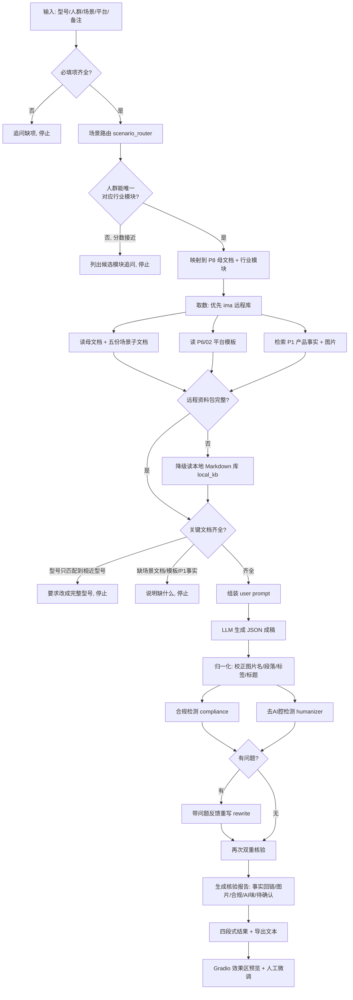

# 华为 PC 营销软文智能体 · 技术架构文档

## 1. 一句话定位

输入「型号 + 人群 + 场景 + 平台」，智能体先把人群路由到 P8 行业场景方法论，从知识库取回场景文档、平台模板与产品事实，交给大模型生成图文软文，再经「合规 + 去 AI 腔」双重核验与自动改写闭环，最终产出一篇可人工微调、带来源回链的成稿。

## 2. 核心设计理念：知识库职责分离

整个系统建立在一条强约束上——**不同知识库只能承担各自的角色，互不越界**。这是防止大模型"编参数、乱卖点"的根本机制。

| 库 | 角色 | 提供什么 | 严禁用途 |
|----|------|---------|---------|
| **P8 客户场景库** | 方法论 | 母文档 + 行业模块的五份子文档（客户画像 / 问题清单 / 方案输出模板 / 验收清单 / 完整参考案例） | 案例中的学校、人物、数字、结论**不得**进入正文 |
| **P1 产品参数库** | 事实源 | 型号、参数、功能、卖点、图片 | —— |
| **P6 营销素材库** | 成稿形态 | 02-平台模板（篇幅、结构、图文节奏、交付字段） | 正例原句不得照抄；软文/话术**不得**当参数来源 |

一句话：**P8 决定"怎么写、门槛是什么"，P1 决定"写什么事实"，P6 决定"写成什么形态"**。三者在 Prompt 中被明确隔离（见 `agent/prompts.py`）。

## 3. 技术架构分层

```
┌─────────────────────────────────────────────────────────┐
│  交互层   app.py (Gradio Blocks)                          │
│  左侧效果区实时预览 · 右侧按位置编辑 · 图片重选 · 导出文本    │
└───────────────┬─────────────────────────────────────────┘
                │ generate() / refresh()
┌───────────────▼─────────────────────────────────────────┐
│  编排层   pipeline.py  run()                              │
│  追问 → 路由 → 取数 → 生成 → 核验 → 改写闭环 → 核验报告      │
└──┬──────────┬──────────┬──────────┬──────────┬───────────┘
   │          │          │          │          │
┌──▼───┐ ┌───▼────┐ ┌───▼────┐ ┌───▼─────┐ ┌──▼──────────┐
│策略/  │ │场景路由 │ │检索取数 │ │大模型    │ │核验器        │
│追问   │ │router  │ │ima/本地 │ │生成      │ │合规+去AI腔   │
│strategy│ │catalog │ │llm_client│ │compliance   │
└───────┘ └────────┘ └────┬───┘ └─────────┘ │+humanizer   │
                           │                 └─────────────┘
              ┌────────────┴────────────┐
       ┌──────▼───────┐        ┌────────▼────────┐
       │ ima_client   │        │ local_kb        │
       │ 远程共享知识库 │  降级→  │ 本地 Markdown 库 │
       │ (node 脚本)   │        │ (文件系统)       │
       └──────────────┘        └─────────────────┘
```

### 模块职责一览

| 模块 | 职责 |
|------|------|
| `app.py` | Gradio 界面；生成、实时预览、按段落编辑、图片重选、导出 |
| `pipeline.py` | 核心编排；串起全流程并产出四段式结果与核验报告 |
| `strategy.py` | 必填项追问、平台规则（图片数量/是否带标签）、型号精确匹配（exact/nearby/no） |
| `scenario_router.py` | 用关键词把「人群+备注」打分路由到 30 个行业模块之一，歧义则追问 |
| `scenario_catalog.py` | P8 导航地图：11 个母文档、30 个行业模块、五份子文档角色——只存名称，不存正文 |
| `ima_client.py` | 通过官方 `ima_api.cjs`(node) 调远程知识库：搜索、读正文、下载图片到本地缓存 |
| `local_kb.py` | 远程不可用时的降级：从本地 Markdown 知识库读同样的文档结构 |
| `prompts.py` | 系统 Prompt：职责分离、合规、反 AI 腔、JSON 输出契约 |
| `llm_client.py` | 兼容 OpenAI 接口的大模型调用，强制解析为 JSON |
| `compliance.py` | 合规检测：绝对化用语、虚假体验、无依据价格/促销词 |
| `humanizer.py` | 去 AI 腔检测：营销套词、套话、排比、句长方差等（只检测不改写） |
| `render.py` | 把成稿渲染成带图页面（图片内嵌 base64 / gradio file url） |
| `editor.py` | 成稿 ↔ 可编辑字段互转，支持按位置插图与实时核验 |
| `config.py` | 读 `.env`、凭证状态检测 |

## 4. Agent 执行流程（技术路线图）

这是 `pipeline.run()` 的完整决策链。任何一环缺依据，流程**主动停下并说明停在哪一步**，绝不"硬编"。



### 流程要点

1. **两道追问闸门**：必填项缺失、人群路由歧义——都先问清楚再往下走，不猜。
2. **型号精确性**：`classify_title` 区分 `exact / nearby / no`。相近型号（如带 Pro/SE/Ultra 后缀）的资料**不会**被拿来补参数，只会提示"是否要改成完整型号"。
3. **双知识库降级**：ima 远程库凭证缺失或资料包不完整时，无缝切到本地 Markdown 库，文档结构完全对齐。
4. **生成-核验-改写闭环**：首稿若命中合规或 AI 腔问题，自动带着问题清单重写一次，再核验；改写只改措辞节奏，**不许动 P1 事实、数字、结构**。
5. **事实可回链**：每条 fact 都要标 `source_title`，核验时与检索到的 P1 资料标题比对，对不上就标"待确认"。
6. **图片强约束**：只能用本次检索到、型号一致的图片，文件名必须完全匹配；张数按平台模板，`_prefer_varied_images` 保证主题多样性。

## 5. 两个核验器（质量防线）

| 维度 | 实现 | 命中示例 |
|------|------|---------|
| **合规** `compliance.py` | 关键词 + 正则 | 「最/第一/唯一/吊打」绝对化；小红书"亲测/我家"虚假体验；资料里没有的价格、补贴、库存 |
| **去 AI 腔** `humanizer.py` | 黑名单 + 正则 + 句长统计方差 | 「赋能/打造/沉浸式」营销套词；"在当今…"开头套话；"不仅…更是…"排比；三词并列；句长过于均匀 |

两者同形状（输入成稿 → 返回问题列表 → 交 pipeline 改写），但**只检测不改写**，改写由大模型在闭环里完成。`humanizer` 的规则参考了 humanizer-zh(MIT)，并按中文营销软文裁剪。

## 6. 技术栈

- **界面**：Gradio Blocks（实时预览 + 分区编辑）
- **大模型**：兼容 OpenAI `/chat/completions` 接口，默认 DeepSeek，可切通义千问等；`temperature=0.3`，强制 JSON 输出
- **知识库接入**：官方 `ima_api.cjs`（Node.js 子进程），参数由 Python 直传、不经 shell；图片下载到本地缓存避免暴露带签名临时链接
- **降级存储**：本地 Markdown 知识库（文件系统 rglob）
- **零重型依赖**：检索、下载、合规、去 AI 腔均为标准库 + 正则实现，可离线做规则检查（`test_core.py`）

## 7. 后续技术路线图（演进方向）

> 以下为基于当前架构的演进建议，非既有功能。

**近期（打磨 Demo）**
- 检索召回：`search_knowledge` 目前靠标题关键词匹配，可引入向量检索提升 P1 事实与图片的召回准确率
- 核验增强：合规/去 AI 腔词表当前为静态黑名单，可接入可配置规则文件，支持按平台/行业定制
- 多轮追问：把"停止并追问"升级为对话式补全，用户可在同一会话内补齐缺项继续生成

**中期（能力扩展）**
- 多模态：当前图片仅做"选用+校名"，可引入图像理解自动生成/校对图片说明与插入位置
- 视频脚本：PLATFORMS 已含抖音/视频号/B站等，可把"图文成稿"扩展为"分镜脚本 + 口播稿"
- A/B 文案：一次生成多版标题已有（title_options），可扩展为多版正文供投放侧挑选

**远期（平台化）**
- 知识库自更新：P1 产品库随新品上市自动同步，型号匹配规则（EXTRA_MODEL_WORDS）自动维护
- 效果回流：接入投放数据，用真实点击/转化反哺 Prompt 与模板选择
- 智能体编排：把"路由→取数→生成→核验"拆成可观测、可重试的 Agent 工作流，支持人工在任意节点介入

## 8. 设计亮点小结

1. **强约束反幻觉**——职责分离 + 事实回链 + 型号精确匹配，从机制上杜绝编参数。
2. **优雅降级**——远程/本地双库无缝切换，无凭证也能跑检索并明确告知停在哪。
3. **质量闭环**——合规与去 AI 腔双检测 + 自动改写，产出"像真人写的、不违规、有依据"的软文。
4. **人在环中**——生成后可按段落改文字、重选配图，效果区实时预览，核验结果同步更新。
